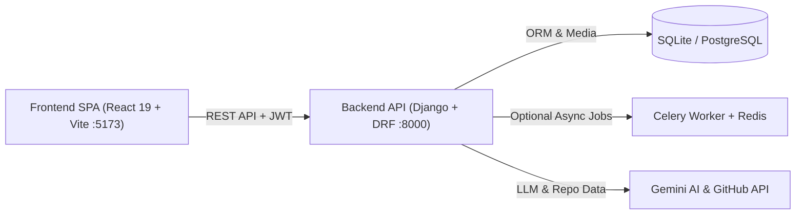

<h1 align="center">
  
  SkillForge
</h1>

<p align="center">
  <strong>AI Skill Verification, Proctored Assessment & Empirical Talent Matching Platform</strong>
</p>

<p align="center">
  <a href="https://react.dev"></a>
  <a href="https://vitejs.dev"></a>
  <a href="https://www.djangoproject.com"></a>
  <a href="https://www.python.org"></a>
  <a href="https://zustand-demo.pmnd.rs"></a>
  <a href="https://tailwindcss.com"></a>
</p>

---

## Table of Contents

- [Overview](#overview)
- [System Architecture](#system-architecture)
- [How to Run the Project](#how-to-run-the-project)
  - [Prerequisites](#prerequisites)
  - [1. First-Time Setup](#1-first-time-setup)
  - [Option A: Concurrent Dev Launcher](#option-a-concurrent-dev-launcher)
  - [Option B: Separate Terminals](#option-b-separate-terminals)
  - [Option C: Docker Compose](#option-c-docker-compose)
- [Service URLs and Demo Accounts](#service-urls-and-demo-accounts)
- [Environment Configuration](#environment-configuration)
- [Core Platform Features](#core-platform-features)
- [Testing, Linting and Builds](#testing-linting-and-builds)
- [Repository Structure](#repository-structure)
- [Documentation Index](#documentation-index)

---

## Overview

**SkillForge** connects verified engineering candidates with hiring teams through empirical skill evaluation rather than unverified resume claims:

- **Candidates (`/student/*`)**:
  - Upload a PDF resume and link a GitHub profile during onboarding.
  - Inspect a **Structured Cross-Domain AI Analysis** mapping real evidence from resume bullets and GitHub repositories across technical domains.
  - Complete **proctored technical assessments** with hardware webcam checks, fullscreen enforcement, and integrity risk scoring.
  - Take a **psychometric learning-style test**, generate adaptive **AI upskilling guides**, and apply to ranked **Job Matches**.
- **Recruiters (`/client/*`)**:
  - Publish role requisitions with required skills and minimum qualification scores.
  - Review applicants ranked by **TF-IDF cosine similarity**, composite verification ratings, and proctor trust telemetry.

---

## System Architecture



### Component Breakdown

| Layer | Directory / Module | Responsibility |
| :--- | :--- | :--- |
| **Frontend SPA** | [`client/`](client/README.md) | React 19 UI, Zustand auth/theme state, route guards, webcam proctoring, JWT client |
| **Core & Auth** | `server/accounts/` | Custom `User` model, JWT auth & refresh rotation, role onboarding, strict PDF validator |
| **AI Verification** | `server/verification/` | Cross-domain resume + GitHub analyzer, dynamic test generation, psychometric scoring |
| **Proctoring Engine** | `server/proctor/` | Exam sessions, telemetry logging (tab switch, fullscreen, camera), weighted risk score |
| **Job Matching** | `server/project/` | Recruiter job postings, application workflow, TF-IDF + cosine candidate ranking |
| **Adaptive Upskilling** | `server/modules/` | Personalized Markdown learning modules calibrated to assessment gaps and pace |

---

## How to Run the Project

### Prerequisites

- **Python**: `3.11+` (`3.10+` supported)
- **Node.js & npm**: Node `20+` and npm `10+`
- **Google Gemini API Key**: Required for live AI analysis, test generation, and upskilling guides ([Google AI Studio](https://aistudio.google.com/apikey))
- **Redis**: `7.x` *(optional for local dev — you can run async tasks synchronously without Redis by setting `CELERY_ALWAYS_EAGER=True`)*

---

### 1. First-Time Setup

Clone the repository and configure both backend and frontend dependencies once:

```bash
# 1. Configure Environment Files
# On Windows PowerShell: Copy-Item instead of cp also works
cp server/.env.example server/.env
cp client/.env.example client/.env
```

Edit `server/.env` and set your API key (plus `CELERY_ALWAYS_EAGER=True` if running locally without Redis):

```env
GEMINI_API_KEY=your_gemini_api_key_here
CELERY_ALWAYS_EAGER=True
```

Install dependencies and prepare the database:

```bash
# 2. Backend Setup
cd server
python -m venv venv

# Activate virtual environment:
# Windows (PowerShell): .\venv\Scripts\Activate.ps1
# macOS / Linux:        source venv/bin/activate

pip install -r requirements.txt
python manage.py migrate
python manage.py seed_demo_data
cd ..

# 3. Frontend Setup
npm install --prefix client
```

---

### Option A: Concurrent Dev Launcher

**(Recommended)** With the backend virtual environment (`server/venv`) activated in your terminal, launch both Django (`:8000`) and Vite (`:5173`) from the repository root with unified color-coded logs:

```bash
# Make sure server/venv is active first so Django finds installed packages
npm run dev
# Or equivalently:
python run_dev.py
```

Press `Ctrl+C` at any time to cleanly terminate both dev servers.

---

### Option B: Separate Terminals

If you prefer dedicated terminal panes (or want to run a real Redis + Celery worker):

**Terminal 1 — Backend API (`http://localhost:8000`)**
```bash
cd server
# Activate venv: .\venv\Scripts\Activate.ps1 (Windows) or source venv/bin/activate (macOS/Linux)
python manage.py runserver 8000
```

**Terminal 2 — Frontend Dev Server (`http://localhost:5173`)**
```bash
cd client
npm run dev
```

**Terminal 3 — Celery Worker *(only needed when `CELERY_ALWAYS_EAGER=False` with Redis running)***
```bash
cd server
# Activate venv first
# macOS / Linux:
celery -A skillforge worker -l info
# Windows:
celery -A skillforge worker -l info --pool=solo
```

---

### Option C: Docker Compose

Run Redis, Django backend, Celery worker, and Nginx-served frontend in containers:

```bash
# Ensure server/.env exists first
cp server/.env.example server/.env

docker compose up --build
```

On a fresh database volume, run migrations and seed demo accounts inside the running backend container:

```bash
docker compose exec backend python manage.py migrate
docker compose exec backend python manage.py seed_demo_data
```

---

## Service URLs and Demo Accounts

Once running, access the services locally at:

| Service | URL | Notes |
| :--- | :--- | :--- |
| **Frontend App** | `http://localhost:5173` | React + Vite web application |
| **Backend REST API** | `http://localhost:8000/api/` | Base API prefix |
| **Swagger API Docs** | `http://localhost:8000/api/docs/` | Interactive OpenAPI explorer |
| **OpenAPI Schema** | `http://localhost:8000/api/schema/` | Raw OpenAPI 3 specification |
| **Django Admin** | `http://localhost:8000/admin/` | Database administration interface |
| **Redis Broker** | `localhost:6379` | Used by Celery when enabled |

### Seeded Demo Credentials

Running `python manage.py seed_demo_data` creates two ready-to-use accounts (safe and idempotent to re-run):

| Role | Email | Password |
| :--- | :--- | :--- |
| **Candidate / Student** | `student@example.com` | `Password123!` |
| **Recruiter / Client** | `recruiter@example.com` | `Password123!` |

---

## Environment Configuration

### Backend (`server/.env`)

Template at [`server/.env.example`](server/.env.example):

| Variable | Default / Example | Purpose |
| :--- | :--- | :--- |
| `DJANGO_SECRET_KEY` | `django-insecure-...` | Signing key (**must** be replaced when `DJANGO_DEBUG=False`) |
| `DJANGO_DEBUG` | `True` | Enables debug mode (`False` enforces HTTPS & secret key guards) |
| `DJANGO_ALLOWED_HOSTS` | `localhost,127.0.0.1` | Comma-separated allowed hostnames |
| `CORS_ALLOWED_ORIGINS` | `http://localhost:5173,http://127.0.0.1:5173` | Allowed frontend origins |
| `GEMINI_API_KEY` | `your_gemini_api_key_here` | Google Gemini API key (`GOOGLE_API_KEY` is also accepted) |
| `GITHUB_TOKEN` | *(optional)* | Personal access token to increase GitHub REST rate limits |
| `REDIS_URL` | `redis://localhost:6379/0` | Broker & result backend URL for Celery |
| `CELERY_ALWAYS_EAGER` | `True` *(for local dev without Redis)* | Runs Celery tasks synchronously in-process when `True` |
| `DATABASE_URL` | *(defaults to SQLite `server/db.sqlite3`)* | PostgreSQL connection string for production |

### Frontend (`client/.env`)

Template at [`client/.env.example`](client/.env.example):

| Variable | Default | Purpose |
| :--- | :--- | :--- |
| `VITE_API_BASE_URL` | `http://localhost:8000/api` | Base URL for backend API requests |

---

## Core Platform Features

- **Structured Cross-Domain AI Analysis**: Extracts resume text (`PyPDF2`) and inspects public GitHub repositories (`requests` with automatic retry/backoff), producing a categorized audit across domains (`Backend`, `Frontend`, `AI & Data`, `Systems & Security`, `DevOps & Tooling`, etc.) via Gemini (`gemini-2.5-flash`) with deterministic fallback.
- **Anti-Cheat Proctoring Engine**: Monitors fullscreen exits, tab switches, copy/paste events, and webcam presence during assessments, releasing camera `MediaStream` tracks cleanly upon unmount.
- **Security Hardening**: 4-stage PDF validation (`<= 5 MB`, `.pdf` extension, MIME check, `%PDF-` magic header) with UUID filenames, XML-quarantined prompts against prompt injection, and fail-fast production `SECRET_KEY` enforcement.
- **Resilient API Client**: Centralized fetch client in [`client/src/lib/api.js`](client/src/lib/api.js) handles silent JWT refresh/rotation and clean network-offline error responses, paired with a global [`ErrorBoundary.jsx`](client/src/components/common/ErrorBoundary.jsx).

---

## Testing, Linting and Builds

Always run Django test discovery **from inside `server/`** (running `python server/manage.py test` from the repository root discovers 0 tests):

```bash
# Backend checks & test suite (31 unit and integration tests)
cd server
python manage.py check
python manage.py test
cd ..

# Frontend linting & production bundle
npm run lint --prefix client
npm run build --prefix client
```

Automated checks run via GitHub Actions in [`.github/workflows/ci.yml`](.github/workflows/ci.yml).

---

## Repository Structure

```text
SkillForge/
├── client/                     # React 19 + Vite 7 Frontend SPA
│   ├── public/                 # Favicon suite (SVG, ICO, PNG 16/32, apple-touch-icon, manifest)
│   └── src/
│       ├── api/                # API facade
│       ├── components/         # Modular UI (assessment, auth, client, common, guards, layout, student, ui)
│       ├── hooks/              # useTaskStatus polling hook
│       ├── lib/                # JWT fetch wrapper (api.js) & className helper (cn.js)
│       ├── pages/              # Landing, Auth, Student & Client dashboards, Analysis, Job Matches, Upskill
│       └── store/              # Zustand stores (authStore, themeStore)
├── server/                     # Django 5.2+ & DRF Backend API
│   ├── accounts/               # Users, JWT auth, onboarding, PDF validators, seed_demo_data command
│   ├── verification/           # AI test gen, grading, GitHub/PDF utils, domain_analyzer, Celery tasks
│   ├── proctor/                # Assessment exam sessions, event telemetry, risk engine
│   ├── project/                # Client job posts, applications, TF-IDF matching
│   ├── modules/                # AI upskilling curriculum generation & progress tracking
│   ├── skillforge/             # Settings, URLs, Swagger docs, Celery app, permissions
│   └── manage.py               # Django CLI
├── assets/                     # Branding SVGs, screenshots, and logos
├── project_knowledge/          # System architecture & deep-dive technical notes
├── .github/workflows/ci.yml    # GitHub Actions CI workflow
├── docker-compose.yml          # Full-stack Docker setup (Redis, Backend, Worker, Frontend)
├── package.json                # Root monorepo convenience scripts
└── run_dev.py                  # Concurrent Django + Vite launcher
```

---

## Documentation Index

- **Backend Guide**: [`server/README.md`](server/README.md)
- **Frontend Guide**: [`client/README.md`](client/README.md)
- **System Overview**: [`project_knowledge/00_SYSTEM_OVERVIEW.md`](project_knowledge/00_SYSTEM_OVERVIEW.md)
- **Architecture & Dataflow**: [`project_knowledge/01_ARCHITECTURE_AND_DATAFLOW.md`](project_knowledge/01_ARCHITECTURE_AND_DATAFLOW.md)
- **Backend Deep Dive**: [`project_knowledge/02_BACKEND_DEEP_DIVE.md`](project_knowledge/02_BACKEND_DEEP_DIVE.md)
- **Frontend Deep Dive**: [`project_knowledge/03_FRONTEND_DEEP_DIVE.md`](project_knowledge/03_FRONTEND_DEEP_DIVE.md)
- **Environment & DevOps**: [`project_knowledge/04_ENVIRONMENT_AND_DEVOPS.md`](project_knowledge/04_ENVIRONMENT_AND_DEVOPS.md)
