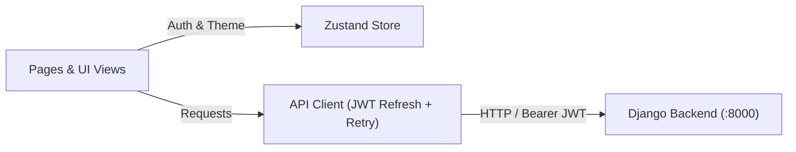

# SkillForge Frontend (React 19 + Vite)

The `client/` workspace is SkillForge's single-page application (SPA), built with React 19, Vite 7, Tailwind CSS 3, Zustand, and Framer Motion for candidates and recruiters.

---

## Architecture Overview



---

## Design & Technical Highlights

- **Dark Studio Monochrome UI**: Unified `#060709` canvas, `#0D0F14` surface panels, crisp `#111318` overlays, monospace typography (`Consolas` / `Courier Prime`), custom hairline monochrome SVG icons ([`src/components/ui/Icons.jsx`](src/components/ui/Icons.jsx)), and consistent favicon/emblem branding ([`src/components/common/BrandLogo.jsx`](src/components/common/BrandLogo.jsx)).
- **Resilient Centralized API Client**: [`src/lib/api.js`](src/lib/api.js) attaches JWT Bearer tokens, silently rotates expired access tokens via `/api/accounts/token/refresh/`, evicts invalid sessions cleanly, and returns structured `NetworkErrorResponse` objects on offline/connection drops.
- **Global Error Boundary**: [`src/components/common/ErrorBoundary.jsx`](src/components/common/ErrorBoundary.jsx) catches runtime React errors and displays a clean recovery screen without crashing the workspace.
- **Proctoring Cleanup & Polling**: [`ProctorWrapper.jsx`](src/components/assessment/ProctorWrapper.jsx) monitors fullscreen exits, tab switches, and webcam presence while explicitly calling `track.stop()` on unmount so hardware cameras turn off immediately; [`useTaskStatus.js`](src/hooks/useTaskStatus.js) handles async task polling.

---

## Application Routes

| Access | Route | View | Description |
| :--- | :--- | :--- | :--- |
| **Public** | `/` | `LandingPage` | Platform overview & interactive capability showcase |
| **Public** | `/verification`, `/protocol`, `/talent`, `/how-it-works` | Public pages | Verification flow, security specs, talent tiers, walkthrough |
| **Public** | `/auth` | `AuthPage` | Login and 4-step role-aware registration wizard |
| **Student** | `/student/dashboard` | `StudentDashboard` | Verification readiness, metrics & primary action rail |
| **Student** | `/student/onboarding` | `StudentOnboarding` | Resume PDF upload, GitHub handle & skills intake |
| **Student** | `/student/analysis` *(or `/student/ai-analysis`)* | `AiAnalysisPage` | Structured cross-domain Resume & GitHub AI audit |
| **Student** | `/student/assessment` | `AssessmentPage` | Proctored technical exam with fullscreen & webcam guard |
| **Student** | `/student/personality-test` | `PersonalityTest` | 7-question learning-style psychometric profiler |
| **Student** | `/student/upskill` | `UpskillPage` | AI-generated interactive learning guides & progress |
| **Student** | `/student/jobs` *(or `/student/job-matches`)* | `JobMatchesPage` | Algorithmically matched job feed & applications |
| **Client** | `/client/dashboard` | `ClientDashboard` | Job requisitions & TF-IDF ranked applicant dossiers |
| **Client** | `/client/onboarding` | `ClientOnboarding` | Company specification onboarding |

---

## Directory Structure

```text
client/
├── public/                        # Static icons & web manifest
│   ├── apple-touch-icon.png       # Master emblem reused by BrandLogo & touch icons
│   ├── favicon.svg                # Vector emblem favicon
│   ├── favicon.ico                # Fallback ICO favicon
│   ├── favicon-16x16.png
│   ├── favicon-32x32.png
│   └── site.webmanifest
├── scripts/
│   └── generate-favicons.mjs      # Generates PNG/ICO favicon assets from SVG
├── src/
│   ├── api/                       # API facade
│   ├── components/
│   │   ├── assessment/            # ProctorWrapper, AssessmentHeader, QuestionWorkspace, OptionsMatrix
│   │   ├── auth/                  # LoginForm, RegisterWizard, 4 onboarding step views
│   │   ├── client/                # ActiveJobsTableBlock, ApplicantRankingsGrid, CandidateDossierModal
│   │   ├── common/                # BrandLogo, ErrorBoundary, Button, Input, Card, Badge
│   │   ├── guards/                # ProtectedRoute & RoleGuard RBAC wrappers
│   │   ├── layout/                # Navbar, CardNav
│   │   ├── modals/                # JobPostModal
│   │   ├── onboarding/            # ResumeUploadZone, ParsedTelemetryPreview, CompanySpecForm
│   │   ├── personality/           # PersonalityIntroCard, QuestionCard, ResultCard
│   │   ├── sections/              # Landing sections & hero subcomponents
│   │   ├── student/               # StructuredEvaluationView, StudentHeader, StudentSidebar, MatchedPositionsGrid
│   │   ├── ui/                    # Custom SVG Icons.jsx & animation primitives (CadGridBackground, etc.)
│   │   └── upskill/               # MarkdownContentReader, ModuleCompletionActions, UpskillHeader
│   ├── hooks/                     # useTaskStatus.js
│   ├── lib/                       # api.js & cn.js
│   ├── pages/                     # Public, auth, student, client & dashboard routes
│   ├── store/                     # Zustand authStore.js & themeStore.js
│   ├── App.jsx                    # Route table
│   ├── main.jsx                   # Entry root wrapped with ErrorBoundary
│   └── index.css                  # Dark monochrome CSS theme & Tailwind directives
├── .env.example                   # Frontend environment template
├── Dockerfile                     # Multi-stage Node 20 + Nginx build
├── nginx.conf                     # Nginx SPA fallback config
├── eslint.config.js               # ESLint 9 rules for React 19
└── package.json
```

---

## Prerequisites

- **Node.js**: `20.x+`
- **npm**: `10.x+`
- **Backend API**: Running on `http://localhost:8000` (see [`../server/README.md`](../server/README.md))

---

## Local Setup & Commands

### 1. Install Dependencies & Configure Env

```bash
cd client
npm install
cp .env.example .env
```

Default `.env` value:

```env
VITE_API_BASE_URL=http://localhost:8000/api
```

### 2. Run Development Server

```bash
npm run dev
```

App runs at `http://localhost:5173`. Ensure the Django backend is running on port `8000` so login, onboarding, AI analysis, and job feeds function properly.

### 3. Quality & Production Build Commands

```bash
# Run ESLint across source files
npm run lint

# Build optimized production bundle to dist/
npm run build

# Preview production build locally
npm run preview

# Regenerate favicon PNG/ICO suite from SVG source
npm run generate:favicons
```
