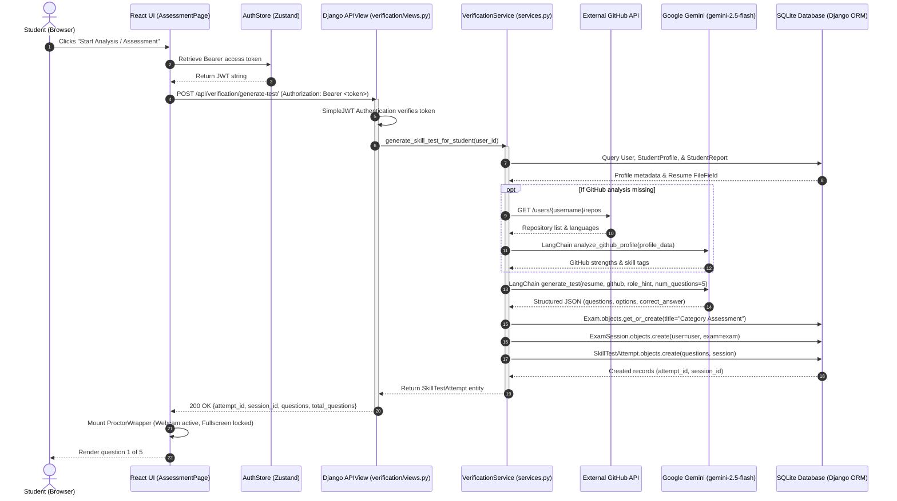
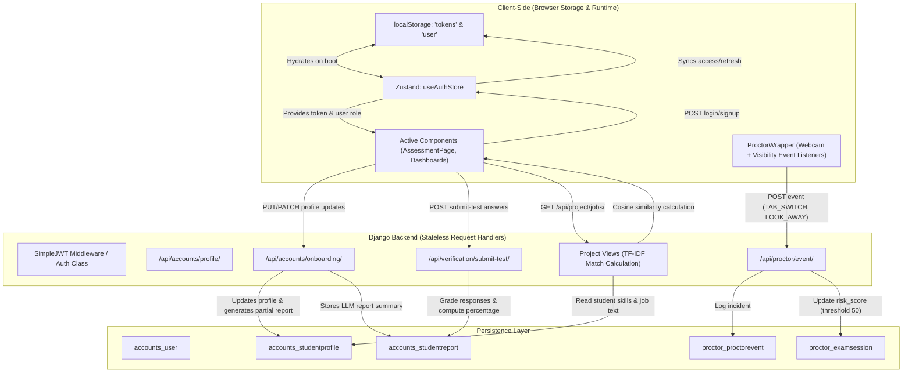

# 01: Architecture and Dataflow

## 1. High-Level Architectural Design

SkillForge utilizes a **Decoupled Single Page Application (SPA) + REST API Monolith** architecture.

```
┌────────────────────────────────────────────────────────┐
│                   CLIENT TIER (BROWSER)                │
│                                                        │
│  React 19 SPA (Vite Dev / Dist Bundles)                │
│  ├── React Router DOM (Navigation & Pages)             │
│  ├── Zustand Global Stores (AuthStore, ThemeStore)     │
│  ├── Hardware Access (React Webcam, Fullscreen API)    │
│  └── Raw fetch() API Calls (Bearer JWT Authorization)  │
└───────────────────────────┬────────────────────────────┘
                            │
              HTTP / JSON   │ Cross-Origin Requests
       (http://localhost:8000/api/*)
                            │
┌───────────────────────────▼────────────────────────────┐
│                  BACKEND TIER (DJANGO)                 │
│                                                        │
│  Django 5.2.5 REST Framework Monolith                  │
│  ├── CORS Headers Middleware (CORS_ALLOW_ALL_ORIGINS)  │
│  ├── SimpleJWT Authentication Handler                  │
│  ├── Domain Route Dispatcher (urls.py namespaces)      │
│  ├── DRF APIViews & ModelSerializers                   │
│  ├── Scikit-Learn TF-IDF Matching Engine               │
│  ├── LangChain Core + Google GenAI (gemini-2.5-flash)  │
│  └── Django ORM Layer                                  │
└───────────────────────────┬────────────────────────────┘
                            │
               SQL Queries  │ Direct File Storage
                            │
┌───────────────────────────▼────────────────────────────┐
│                    PERSISTENCE & I/O                   │
│                                                        │
│  ├── SQLite Database (`db.sqlite3`)                    │
│  ├── Local Filesystem Storage (`resumes/`, media/)     │
│  ├── External Google Gemini API (LLM Cloud)            │
│  └── External GitHub REST API (v3 User Endpoints)      │
└────────────────────────────────────────────────────────┘
```

### Architectural Characteristics
1. **Decoupled Client-Server:** The frontend is entirely separated from Django template rendering (except for an orphaned `templates/proctor.html` debug artifact). Communication is 100% stateless HTTP JSON payload transfer.
2. **Missing Reverse Proxy / API Gateway:** The client directly calls `http://localhost:8000/api/...` without an Nginx, Traefik, or Vite dev proxy configuration. Consequently, `CORS_ALLOW_ALL_ORIGINS = True` is enabled in `skillforge/skillforge/settings.py:50`.
3. **Synchronous Execution Model:** Long-running AI operations (such as multi-stage PDF resume parsing, GitHub profile scraping, test question synthesis, and TF-IDF matrix computation) run synchronously within Django's WSGI request/response thread.
4. **Relational Data Mapping with Dynamic JSON:** Django ORM models maintain relational structures for identity and foreign keys, but store flexible payload outputs (such as generated test questions, submitted answers, and LLM evaluations) inside PostgreSQL/SQLite-compatible `JSONField` columns.

---

## 2. Mermaid.js System Flow Diagrams

### Diagram 1: End-to-End Request/Response Lifecycle

The diagram below tracks a candidate requesting an adaptive technical exam: the request travels from the browser, passes through JWT validation, triggers external PDF/GitHub scraping and Gemini LLM invocation, provisions a proctored exam session, and commits to SQLite.



---

### Diagram 2: State Management & Client-Server Sync

This diagram illustrates how authentication credentials, profile modifications, and AI evaluations flow between browser storage, local component memory, and backend tables.



---

## 3. Cross-Cutting Concerns

### 1. Authentication
- **Mechanism:** JWT (JSON Web Tokens) managed via `djangorestframework_simplejwt`.
- **Default Authentication Class:** Configured globally in `skillforge/skillforge/settings.py:56-60`:
  ```python
  REST_FRAMEWORK = {
      'DEFAULT_AUTHENTICATION_CLASSES': (
          'rest_framework_simplejwt.authentication.JWTAuthentication',
      )
  }
  ```
- **Custom User Model:** The system declares `AUTH_USER_MODEL = "accounts.User"` in `skillforge/skillforge/settings.py:61`. The model uses email as the primary credential (`USERNAME_FIELD = "email"`), omitting the standard Django `username` column.
- **Client Token Storage:** The client stores `{ access, refresh }` in browser `localStorage` under the single key `'tokens'`. It passes the access token in HTTP request headers: `Authorization: Bearer <access_token>`.

### 2. Authorization & Role-Based Access Control (RBAC)
- **Role Definition:** The user model defines 3 roles: `student`, `client`, and `admin` (`accounts/models.py:24-28`).
- **Enforcement Pattern:** RBAC is enforced imperatively at the controller view level rather than declaratively via DRF permission classes (`rest_framework.permissions.BasePermission`).
  - Example in `project/views.py:13`:
    ```python
    if request.user.role != 'client':
        return Response({"error": "Only clients can post jobs"}, status=403)
    ```
  - Example in `project/views.py:125`:
    ```python
    if request.user.role != 'student':
        return Response({"error": "Only students can apply"}, status=403)
    ```
- **Profile Signal Generation:** An automated post-save signal (`accounts/models.py:157-163`) automatically creates a `StudentProfile` or `ClientProfile` instance when a new `User` is registered.

### 3. Session Management & Proctor Integrity
- **Exam Sessions:** An active exam creates an `ExamSession` record (`proctor/models.py:25-38`) tracking `started_at`, `ended_at`, `risk_score`, and `is_flagged`.
- **Anti-Cheat Heuristic Engine:** `proctor/risk.py` increments cumulative penalty points:
  - `NO_FACE`: +10 points
  - `LOOK_AWAY`: +5 points
  - `AUDIO`: +10 points
  - `TAB_SWITCH`: +15 points
  - `MULTI_FACE`: +30 points
  - Flag threshold is hardcoded at **50 points** (`THRESHOLD = 50`). If exceeded, `is_flagged = True`.
- **Disqualification Safeguard:** When submitting an assessment (`verification/services.py:151-156`), if `session.is_flagged` is `True`, the exam evaluation aborts and returns status `"flagged"`.

### 4. Error Handling
- **Backend Error Handling:** Inconsistently structured. Several critical service entry points utilize blanket `try...except Exception` blocks that log the exception and either return `None` or re-raise generic 500 responses without detailed contextual payload error codes.
  - In `verification/services.py:54-66`, a failed LLM extraction falls back to writing `{"error": "AI analysis failed. Please retry."}` into `StudentReport.report_summary`.
- **Frontend Error Handling:** Implemented at component level using `try...catch` surrounding `fetch()` promises, logging to `console.error()`, and falling back to browser `alert()` popups.

### 5. Logging
- **Current State:** Python standard library `logging.getLogger(__name__)` is imported in `verification/services.py`, with `logger.exception()` called on task failures.
- **Missing Global Logging Configuration:** There is no `LOGGING` dictionary defined in `skillforge/skillforge/settings.py`. All output defaults to standard error (`stderr`) through Django's basic root logger.
