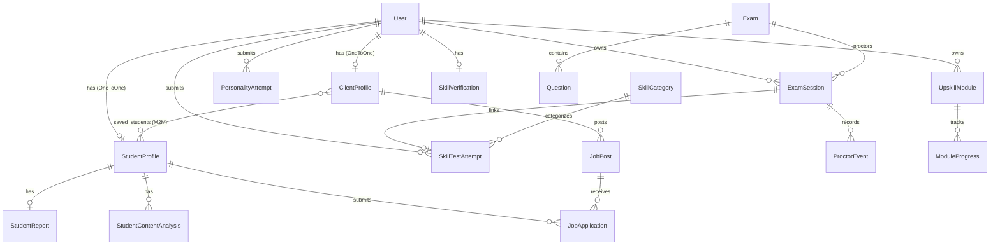

# 02: Backend Deep Dive

## 1. Application Entry Points and Server Initialization Flow

### Execution Entry Points
1. **CLI / Local Development:** `skillforge/manage.py`
   - Sets environment variable `DJANGO_SETTINGS_MODULE = 'skillforge.settings'`
   - Invokes `django.core.management.execute_from_command_line(sys.argv)`.
2. **WSGI Server Execution:** `skillforge/skillforge/wsgi.py`
   - Standard WSGI entry point exposing `application = get_wsgi_application()`. Used by Gunicorn/uWSGI in production.
3. **ASGI Server Execution:** `skillforge/skillforge/asgi.py`
   - Default asynchronous entry point exposing `application = get_asgi_application()`. Currently does not implement ASGI channel layers or WebSocket routers.

### Initialization & Startup Flow
```
manage.py runserver
  │
  ├── 1. Load settings (skillforge/skillforge/settings.py)
  │      ├── Configure INSTALLED_APPS (accounts, proctor, project, verification, analysis, modules)
  │      ├── Configure MIDDLEWARE (CorsMiddleware, Security, Sessions, Common, CSRF, Auth, Messages)
  │      └── Define AUTH_USER_MODEL = "accounts.User"
  │
  ├── 2. Django App Registry Initialization (AppConfig.ready())
  │      ├── accounts/apps.py: registers post_save signal in accounts/models.py:157
  │      └── Imports submodules and utilities
  │          └── ⚠️ CRITICAL IMPORT HAZARD:
  │              - verification/utils/langchain_utils.py:9 and modules/langchain_utils.py:9
  │                execute os.getenv("GEMINI_API_KEY") at module top-level.
  │                If undefined, raising ValueError prevents server initialization.
  │
  └── 3. URL Dispatcher Compilation (skillforge/skillforge/urls.py)
         ├── /admin/                -> django.contrib.admin.site.urls
         ├── /api/accounts/        -> accounts.urls
         ├── /api/proctor/         -> proctor.urls
         ├── /api/project/         -> project.urls
         ├── /api/verification/   -> verification.urls
         └── /api/modules/        -> modules.urls
```

---

## 2. API Layer Breakdown

### Authentication & Account Endpoints (`accounts/urls.py`)

| Endpoint | Verb | Auth / Permissions | Request Contract | Response Contract | Middleware / Validation |
| :--- | :--- | :--- | :--- | :--- | :--- |
| `/api/accounts/register/` | `POST` | `AllowAny` (`permission_classes = []`) | `{"email": "...", "password": "...", "role": "student\|client"}` | `{"message": "Registered successfully", "tokens": {"access": "...", "refresh": "..."}}` | `RegisterSerializer` validates email uniqueness and creates user |
| `/api/accounts/login/` | `POST` | `AllowAny` (`permission_classes = []`) | `{"email": "...", "password": "..."}` | `{"tokens": {"access": "...", "refresh": "..."}, "role": "...", "onboarding_stage": int}` | `LoginSerializer` validates via `authenticate(email, password)` |
| `/api/accounts/onboarding/` | `PUT` | `IsAuthenticated` | Role-dependent: `StudentOnboardingSerializer` (full_name, bio, education, skills, resume) OR `ClientOnboardingSerializer` (company_name, industry, website, address) | `{"message": "Onboarding completed successfully", "profile": {...}}` | Blocks request if `user.onboarding_stage >= 2`. Triggers `generate_partial_report(user.id)`. Sets `onboarding_stage = 2`. |
| `/api/accounts/profile/` | `GET` | `IsAuthenticated` | None | Returns `StudentProfileSerializer` or `ClientProfileSerializer` based on `request.user.role` | Evaluates `request.user.role`; 400 if invalid |
| `/api/accounts/profile/update/` | `PATCH` | `IsAuthenticated` | Partial profile fields | `{"message": "Profile updated", "data": {...}}` | Serializer `partial=True`. Retriggers `generate_partial_report(user.id)`. |
| `/api/accounts/logout/` | `POST` | `IsAuthenticated` | `{"refresh": "<refresh_token_string>"}` | `{"message": "Logged out successfully"}` | Adds refresh token to SimpleJWT token blacklist |

---

### Proctoring & Exam Endpoints (`proctor/urls.py`)

| Endpoint | Verb | Auth / Permissions | Request Contract | Response Contract | Middleware / Validation |
| :--- | :--- | :--- | :--- | :--- | :--- |
| `/api/proctor/list/` | `GET` | `IsAuthenticated` | None | `[{"id": 1, "title": "...", "duration_minutes": 30, "is_active": true}]` | Filters `Exam.objects.filter(is_active=True)` |
| `/api/proctor/start/` | `POST` | `IsAuthenticated` | `{"exam_id": int}` | `{"session_id": int}` | Creates `ExamSession` for user and exam |
| `/api/proctor/<int:exam_id>/questions/` | `GET` | `IsAuthenticated` | URL parameter `exam_id` | `[{"id": 1, "text": "...", "option_a": "...", "option_b": "...", ...}]` | `QuestionSerializer` excludes `correct_option` to prevent cheating |
| `/api/proctor/event/` | `POST` | `IsAuthenticated` | `{"session_id": int, "event_type": str, "confidence": float}` | `{"risk": float, "flagged": bool}` | Logs `ProctorEvent`, updates cumulative risk via `proctor/risk.py`. *(Note: Frontend calls `/events/` causing 404)* |
| `/api/proctor/end/` | `POST` | `IsAuthenticated` | `{"session_id": int}` | `{"final_risk": float, "flagged": bool}` | Deactivates session (`is_active = False`), sets `ended_at = now()` |
| `/api/proctor/test/` | `GET` | None | None | HTML Render (`proctor.html`) | Diagnostic testing page |
| `/api/proctor/auth/register/` | `POST` | `AllowAny` | `{"username": "...", "email": "...", "password": "..."}` | JWT tokens and user object | ⚠️ **BROKEN:** Directly queries default Django `User` model, incompatible with `accounts.User` |
| `/api/proctor/auth/login/` | `POST` | `AllowAny` | `{"username": "...", "password": "..."}` | JWT tokens and user object | ⚠️ **BROKEN:** Authenticates against `username` instead of `email` |

---

### Verification & AI Diagnostic Endpoints (`verification/urls.py`)

| Endpoint | Verb | Auth / Permissions | Request Contract | Response Contract | Middleware / Validation |
| :--- | :--- | :--- | :--- | :--- | :--- |
| `/api/verification/generate-test/` | `POST` | `IsAuthenticated` | Optional: `{"category_id": int}` | `{"attempt_id": int, "session_id": int, "category": str, "questions": [...], "total_questions": 5}` | Invokes `generate_skill_test_for_student(request.user.id)` via Gemini LLM |
| `/api/verification/submit-test/` | `POST` | `IsAuthenticated` | `{"attempt_id": int, "answers": ["A", "C", ...]}` | `{"status": "completed", "score": int, "percentage": float, "passed": bool, "analysis": {...}}` | Grades answers against `correct_answer`. Aborts with `{"status": "flagged"}` if `proctor_session.is_flagged` is True |
| `/api/verification/personality/questions/` | `GET` | `IsAuthenticated` | None | Array of 7 psychometric question objects with weighted answer options | Returns static array `PERSONALITY_QUESTIONS` |
| `/api/verification/personality/submit/` | `POST` | `IsAuthenticated` | `{"answers": {"1": "Start working on it immediately", ...}}` | `{"score": int, "learning_level": "fast\|average\|slow"}` | Scores answers (Max 28). ≥24: Fast, ≥16: Average, <16: Slow. Saves to `StudentReport`. |
| `/api/verification/recommendation/` | `GET` | `IsAuthenticated` | None | `{"status": "ready\|not_ready", "star_rating": float, "strengths": [...], "weaknesses": [...], ...}` | Extracts final evaluation from `StudentReport.report_summary["final"]` |

---

### Project, Job, & Matching Endpoints (`project/urls.py`)

| Endpoint | Verb | Auth / Permissions | Request Contract | Response Contract | Middleware / Validation |
| :--- | :--- | :--- | :--- | :--- | :--- |
| `/api/project/create/` | `POST` | `IsAuthenticated` | `{"title": str, "category": str, "description": str, "budget_type": "fixed\|hourly", "budget_amount": float, "skills_required": str, "min_skill_score": int}` | Serialized `JobPost` record | Imperatively enforces `request.user.role == 'client'`. Requires valid `ClientProfile`. |
| `/api/project/my-jobs/` | `GET` | `IsAuthenticated` | None | Array of `JobPost` objects created by logged-in client | Enforces `request.user.role == 'client'` |
| `/api/project/jobs/` | `GET` | `IsAuthenticated` | None | Array of open `JobPost` objects. If candidate is a student, appends `"match": float` (0-100%) | Computes TF-IDF cosine similarity between student's skills/bio and all open job postings |
| `/api/project/apply/` | `POST` | `IsAuthenticated` | `{"job_id": int}` | `{"message": "Application submitted successfully", "application_id": int}` | Enforces `request.user.role == 'student'`. Prevents duplicate applications via `unique_together` constraint. |
| `/api/project/my-applications/` | `GET` | `IsAuthenticated` | None | Array of `JobApplication` objects with job title and client company name | Enforces `request.user.role == 'student'` |
| `/api/project/applicants/<int:job_id>/` | `GET` | `IsAuthenticated` | URL parameter `job_id` | Array of applicant student objects ordered descending by `"match": float` (0-100%) | Computes TF-IDF similarity between job posting text and each applicant profile |

---

### Upskill Module Endpoints (`modules/urls.py`)

| Endpoint | Verb | Auth / Permissions | Request Contract | Response Contract | Middleware / Validation |
| :--- | :--- | :--- | :--- | :--- | :--- |
| `/api/modules/upskill/generate/` | `POST` | `IsAuthenticated` | `{"topic": "Docker Containers"}` | `{"module_id": int, "topic": str, "level": str}` | Queries candidate's personality score, determines level, calls Gemini LLM, creates `UpskillModule` |
| `/api/modules/upskill/modules/` | `GET` | `IsAuthenticated` | None | Array of `UpskillModule` objects belonging to logged-in user | Ordered by `-created_at` |
| `/api/modules/upskill/<int:module_id>/` | `GET` | `IsAuthenticated` | URL parameter `module_id` | Full `UpskillModule` object including markdown `content` and `ai_metadata` | Validates `user == request.user` |

---

## 3. Business Logic Services & Core Functions

### 1. `verification/services.py`
- `generate_partial_report(student_id: int)`:
  - Extracts text from `profile.resume` using `pdf_utils.extract_text_from_pdf_fileobj`.
  - Runs LangChain chain `analyze_resume` using Gemini 2.5 Flash.
  - Parses GitHub handle from `profile.github_url`, fetches public repos via `git_utils.fetch_github_profile`, and runs `analyze_github_profile`.
  - Runs `generate_final_report` and persists output dictionary to `StudentReport.report_summary`.
- `generate_skill_test_for_student(student_id: int, category_id: int | None)`:
  - Resolves primary skill category from existing profile summary if `category_id` is omitted.
  - Invokes `langchain_utils.generate_test()` requesting 5 scenario-based questions with practical difficulty distribution.
  - Provisions an `Exam` and an active `ExamSession` for proctoring.
  - Persists question payloads inside `SkillTestAttempt.generated_questions`.
- `submit_skill_test(student_id: int, attempt_id: int, answers: list)`:
  - Verifies that `attempt.proctor_session.is_flagged` is `False`.
  - Compares candidate index answers against `question["correct_answer"]`.
  - Calculates passing status (threshold: ≥60%).
  - Invokes LangChain `final_analysis` to produce star rating (1–5) and strengths/weaknesses tags.
- `submit_personality_assessment(user, answers)`:
  - Iterates through the 7 psychometric questions in `verification/personality_data.py`.
  - Calculates cumulative score (Range: 7 to 28). Sets learning level (`fast` ≥24, `average` ≥16, `slow` <16).

### 2. `project/views.py` (NLP Match Engine)
- Implements two-way TF-IDF cosine similarity using `scikit-learn`:
  ```python
  vectorizer = TfidfVectorizer()
  vectors = vectorizer.fit_transform([profile_text] + job_texts)
  scores = cosine_similarity(vectors[0:1], vectors[1:]).flatten()
  ```
  - **Candidate Perspective (`AllJobsAPI`):** Ranks open jobs against candidate skills and education.
  - **Recruiter Perspective (`JobApplicantsAPI`):** Ranks applicants against job description and required skills.

### 3. `proctor/risk.py` (Proctoring Heuristic Engine)
- Maintains session risk scores based on incoming hardware events:
  ```python
  RULES = {"NO_FACE": 10, "MULTI_FACE": 30, "TAB_SWITCH": 15, "AUDIO": 10, "LOOK_AWAY": 5}
  THRESHOLD = 50
  ```
- Flags session immediately when `session.risk_score >= THRESHOLD`.

---

## 4. Data Layer & Persistence Models

### Entity Relationship Diagram



### Model Entity Descriptions

#### `accounts/models.py`
1. `User` (extends `AbstractBaseUser`, `PermissionsMixin`):
   - Fields: `email` (unique, Username Field), `role` (`student`, `client`, `admin`), `verified` (bool), `onboarding_stage` (int), `is_active`, `is_staff`, `date_joined`, `last_login`.
2. `StudentProfile`:
   - One-to-one with `User`. Stores `full_name`, `location`, `bio`, `education`, `experience_level`, `github_url`, `portfolio_links`, `resume` (`FileField(upload_to="resumes/")`), `skills` (`TextField`), `rating` (`DecimalField`).
3. `ClientProfile`:
   - One-to-one with `User`. Stores `company_name`, `industry`, `website`, `address`, `saved_students` (`ManyToManyField(StudentProfile)`).
4. `StudentReport`:
   - One-to-one with `StudentProfile`. Stores `personality_score` (float), `skill_test_score` (float), `report_summary` (`JSONField`), `generated_at`.
5. `StudentContentAnalysis`:
   - Foreign key to `StudentProfile`. Stores `source_type` (`resume` or `github`), `file`, `extracted_keywords` (`JSONField`), `ai_summary` (`JSONField`).

#### `proctor/models.py`
1. `Exam`: `title`, `duration_minutes`, `is_active`.
2. `Question`: FK to `Exam`, `text`, `option_a`, `option_b`, `option_c`, `option_d`, `correct_option` (char).
3. `ExamSession`: FK to `User` and `Exam`, `started_at`, `ended_at`, `risk_score` (float), `is_flagged` (bool), `is_active` (bool).
4. `ProctorEvent`: FK to `ExamSession`, `event_type` (str), `confidence` (float), `timestamp`.

#### `project/models.py`
1. `JobPost`: FK to `ClientProfile`, `title`, `category`, `description`, `budget_type` (`fixed`/`hourly`), `budget_amount` (decimal), `skills_required` (comma-separated string), `min_skill_score` (int), `status` (`open`/`closed`/`draft`).
2. `JobApplication`: FK to `JobPost`, FK to `StudentProfile`, `status` (`pending`/`accepted`/`rejected`), `applied_at`. Unique together: `('job', 'student')`.

#### `verification/models.py`
1. `SkillVerification`: One-to-one with `User`. Stores `resume_analysis`, `github_analysis`, `ai_recommendation`, `trust_score` (default 100), `is_flagged`, `flag_level`, `cheating_events`, `flag_reasons`.
2. `PersonalityAttempt`: FK to `User`, `answers` (`JSONField`), `total_score` (int), `learning_level` (`fast`/`average`/`slow`).
3. `SkillCategory`: `name` (unique), `description`.
4. `SkillTestAttempt`: FK to `User`, FK to `SkillCategory`, One-to-one to `ExamSession`, `generated_questions` (`JSONField`), `submitted_answers` (`JSONField`), `total_questions`, `score`, `percentage`, `passed`, `ai_feedback`, `is_evaluated`.

#### `modules/models.py`
1. `UpskillModule`: FK to `User`, `topic`, `level` (`slow`/`average`/`fast`), `content` (`TextField` markdown), `ai_metadata` (`JSONField`).
2. `ModuleProgress`: FK to `UpskillModule`, `completed` (bool), `completed_at`.

---

## 5. Background Tasks, Queues, and Asynchronous Events

### Current Reality vs. Dependency Manifest
- In `requirements.txt`, the following libraries are installed:
  - `celery`
  - `redis`
  - `channels[daphne]`
  - `channels-redis`
  - `python-socketio`
- **Audit Finding:** None of these libraries are configured in the codebase:
  - No `celery.py` file or `tasks.py` worker modules exist.
  - `settings.py` does not contain `CELERY_BROKER_URL`, `CHANNEL_LAYERS`, or cache configurations.
  - `asgi.py` initializes only standard HTTP ASGI (`get_asgi_application()`).
  - All LLM invocations (`generate_test`, `analyze_resume`, `generate_learning_module`) and web-scraping calls (`fetch_github_profile`) execute **synchronously** inside standard HTTP request threads.
