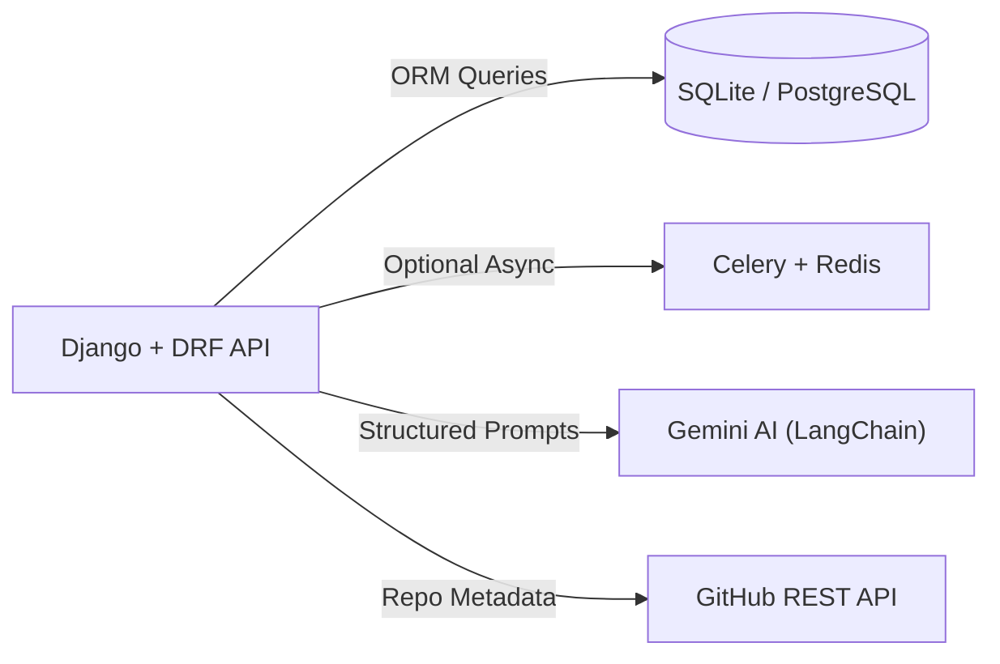

# SkillForge Backend (Django REST Framework)

The `server/` workspace powers SkillForge's REST API, JWT authentication, AI resume & GitHub verification pipeline, anti-cheat proctoring risk engine, TF-IDF candidate matching, and adaptive upskilling modules.

---

## Architecture Overview



### Django Apps & Modules

```text
server/
├── accounts/              # Custom User model, JWT auth, onboarding, profiles, PDF validator
│   ├── management/commands/
│   │   └── seed_demo_data.py  # Idempotent demo users, profiles, jobs & sample application
│   ├── models.py          # User, StudentProfile, ClientProfile, StudentReport, StudentContentAnalysis
│   ├── validators.py      # 4-point PDF upload validator (size, ext, MIME, %PDF- header)
│   └── views.py           # Register, Login, Onboarding, Profile, ProfileUpdate, Logout
├── verification/          # AI verification, GitHub analyzer, test generator & grader
│   ├── domain_analyzer.py # Cross-domain resume + GitHub synthesizer & structured breakdown
│   ├── services.py        # Transactional report generation, grading, and refresh orchestration
│   ├── tasks.py           # Celery background tasks for reports and dynamic test drafting
│   ├── utils/             # Gemini LangChain client, GitHub retry adapter, PyPDF2 parser
│   └── views.py           # GenerateTest, SubmitTest, Personality, Analysis, Refresh, TaskStatus
├── proctor/               # Exam management, telemetry logging & weighted integrity risk scoring
│   ├── models.py          # Exam, Question, ExamSession, ProctorEvent
│   ├── risk.py            # Penalty accumulator & flagging thresholds
│   └── views.py           # List, Start, Questions, Events, End
├── project/               # Job requisitions, applications, and TF-IDF + cosine ranking
│   ├── models.py          # JobPost, JobApplication
│   └── views.py           # CreateJob, ClientJobs, AllJobs, ApplyJob, Applicants, UpdateStatus
├── modules/               # Personalized AI upskilling curriculum and completion tracking
│   ├── models.py          # UpskillModule, ModuleProgress
│   ├── services.py        # Adaptive markdown generation calibrated to learning pace
│   └── views.py           # Generate, List, Detail, Progress
├── skillforge/            # Core project configuration
│   ├── settings.py        # Security guards, SimpleJWT rotation, CORS, DB, logging, Celery
│   ├── urls.py            # Central API routing + Swagger UI (/api/docs/)
│   ├── celery.py          # Celery app and task autodiscovery
│   └── exceptions.py      # Unified DRF exception formatting
├── manage.py
├── requirements.txt
└── Dockerfile
```

---

## Prerequisites

- **Python**: `3.11+` (`3.10+` supported)
- **Redis**: `7.x` *(optional during local development if `CELERY_ALWAYS_EAGER=True`)*
- **Database**: SQLite (`db.sqlite3`, default) or PostgreSQL (`DATABASE_URL`)
- **Gemini API Key**: Required for live AI analysis, test generation, and upskilling guides

---

## Local Setup & Running the Backend

### 1. Create and Activate Virtual Environment

```bash
cd server

# Create virtual environment
python -m venv venv

# Activate on Windows (PowerShell):
.\venv\Scripts\Activate.ps1

# Activate on macOS / Linux:
source venv/bin/activate
```

### 2. Install Dependencies

```bash
pip install -r requirements.txt
```

### 3. Configure Environment Variables

Copy [`.env.example`](.env.example) to `.env`:

```bash
cp .env.example .env
```

Minimum recommended `.env` for local development without Redis:

```env
DJANGO_SECRET_KEY=django-insecure-replace-with-a-secure-random-key-in-production
DJANGO_DEBUG=True
DJANGO_ALLOWED_HOSTS=localhost,127.0.0.1
CORS_ALLOWED_ORIGINS=http://localhost:5173,http://127.0.0.1:5173
REDIS_URL=redis://localhost:6379/0
CELERY_ALWAYS_EAGER=True
GEMINI_API_KEY=your_gemini_api_key_here
GITHUB_TOKEN=optional_github_token_here
```

> **Tip:** Leaving `CELERY_ALWAYS_EAGER=True` executes background tasks synchronously inside the Django process—ideal for local dev when Redis is not running. To test real background workers, set `CELERY_ALWAYS_EAGER=False`, ensure Redis is running on `6379`, and start Celery below.

### 4. Apply Migrations & Seed Demo Data

```bash
python manage.py migrate
python manage.py seed_demo_data
```

This creates two demo accounts (safe to re-run):
- **Student**: `student@example.com` / `Password123!`
- **Recruiter**: `recruiter@example.com` / `Password123!`

### 5. Start the API Server

```bash
python manage.py runserver 8000
```

- **REST API Root**: `http://localhost:8000/api/`
- **Interactive Swagger Docs**: `http://localhost:8000/api/docs/`
- **OpenAPI Schema**: `http://localhost:8000/api/schema/`

### 6. Start Celery Worker *(Optional — only when Redis & async workers are enabled)*

```bash
# macOS / Linux:
celery -A skillforge worker -l info

# Windows:
celery -A skillforge worker -l info --pool=solo
```

---

## Core API Endpoints

| App | Endpoint | Method | Access | Description |
| :--- | :--- | :--- | :--- | :--- |
| **Docs** | `/api/docs/` | GET | Public | Interactive Swagger UI API documentation |
| **Auth** | `/api/accounts/register/` | POST | AllowAny | Register student or client user |
| **Auth** | `/api/accounts/login/` | POST | AllowAny | Authenticate and issue JWT access/refresh pair |
| **Auth** | `/api/accounts/token/refresh/` | POST | AllowAny | Rotate and refresh JWT access token |
| **Auth** | `/api/accounts/onboarding/` | PUT / POST | IsAuthenticated | Save onboarding stage & upload PDF resume |
| **Auth** | `/api/accounts/profile/` | GET | IsAuthenticated | Retrieve authenticated user profile & telemetry |
| **Verify** | `/api/verification/analysis/` | GET | IsStudentUser | Retrieve structured domain breakdown & AI audit |
| **Verify** | `/api/verification/analysis/refresh/` | POST | IsStudentUser | Re-run GitHub & resume analysis |
| **Verify** | `/api/verification/generate-test/` | POST | IsStudentUser | Generate personalized assessment via Gemini |
| **Verify** | `/api/verification/submit-test/` | POST | IsStudentUser | Submit answers, grade, and finalize report |
| **Verify** | `/api/verification/personality/questions/` | GET | IsStudentUser | Fetch 7-question psychometric assessment |
| **Verify** | `/api/verification/personality/submit/` | POST | IsStudentUser | Submit personality answers & learning pace |
| **Verify** | `/api/verification/recommendation/` | GET | IsStudentUser | Get composite verification card & star rating |
| **Verify** | `/api/verification/tasks/<task_id>/status/` | GET | IsAuthenticated | Poll Celery background task progress |
| **Proctor** | `/api/proctor/list/` | GET | IsAuthenticated | List available exams |
| **Proctor** | `/api/proctor/start/` | POST | IsAuthenticated | Start proctored exam session |
| **Proctor** | `/api/proctor/event/` | POST | IsAuthenticated | Log proctoring violation & recompute risk |
| **Proctor** | `/api/proctor/end/` | POST | IsAuthenticated | Complete exam session & lock risk score |
| **Project** | `/api/project/jobs/` | GET | IsAuthenticated | List open jobs ranked with TF-IDF match scores |
| **Project** | `/api/project/create/` | POST | IsClientUser | Publish new job requisition |
| **Project** | `/api/project/apply/` | POST | IsStudentUser | Apply to an open job |
| **Project** | `/api/project/my-jobs/` | GET | IsClientUser | List recruiter's posted requisitions |
| **Project** | `/api/project/my-applications/` | GET | IsStudentUser | List candidate's applications |
| **Project** | `/api/project/applicants/<job_id>/` | GET | IsClientUser | Inspect ranked applicants for a requisition |
| **Modules** | `/api/modules/upskill/generate/` | POST | IsStudentUser | Generate adaptive markdown upskill guide |
| **Modules** | `/api/modules/upskill/modules/` | GET | IsStudentUser | List generated learning modules |
| **Modules** | `/api/modules/upskill/progress/` | GET / POST | IsStudentUser | Track and record module completion |

---

## Security & Reliability Highlights

- **Strict PDF Validation**: [`accounts/validators.py`](accounts/validators.py) enforces a 5 MB cap, `.pdf` extension, MIME verification, and `%PDF-` magic byte inspection; filenames are randomized with UUIDs.
- **Production Secret Guard**: [`skillforge/settings.py`](skillforge/settings.py) raises `ImproperlyConfigured` if `DJANGO_DEBUG=False` with a missing or default `DJANGO_SECRET_KEY`.
- **Prompt Injection Defense & Retries**: [`verification/utils/langchain_utils.py`](verification/utils/langchain_utils.py) quarantines candidate text in XML tags (`<candidate_resume_data>`, `<candidate_github_data>`) with 30s timeouts and structured fallbacks; [`verification/utils/git_utils.py`](verification/utils/git_utils.py) configures automatic `urllib3` retries with exponential backoff.
- **Atomic Transactions & Optimized Queries**: State transitions use `transaction.atomic()`, and recruiter/job feeds use `select_related` and `Count("applications")` annotations to avoid N+1 queries.

---

## Verification & Testing

Run Django commands directly inside `server/` with the virtual environment active:

```bash
# Validate Django setup & URL/model integrity
python manage.py check

# Run complete backend test suite (31 tests across all apps)
python manage.py test
```
